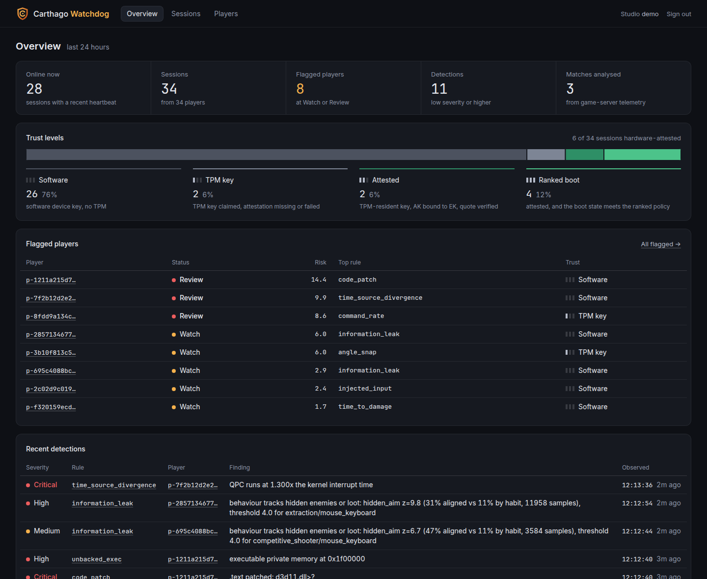

# Carthago Watchdog

**Strong enough for ranked, light enough that players never notice, and no kernel driver in
your store-page disclosure.**

Carthago Watchdog is a user-mode anti-cheat for PC games. A small, fast client SDK acts as a
tamper-resistant sensor inside the game process. A Go backend makes every decision: it
verifies hardware-backed identity, analyses what the client reports and what the game server
saw, and shows the studio exactly why a player was flagged.

There is no ring-0 component and nothing that runs at boot. Instead, the system compensates
for the missing kernel access in four ways:

1. **Server authority.** The client only observes. Thresholds, allowlists and verdicts all
   live on the server, and the game server enforces kicks.
2. **Behavioural and statistical detection** on server-observed gameplay. This doesn't care
   how a cheat is built, so it also catches cheats that never touch the game process.
3. **Platform attestation from user mode.** TPM-bound device keys plus a TPM quote over the
   Windows measured-boot log prove Secure Boot, HVCI, no test signing and no kernel debugger.
4. **Integrity scanning on a strict budget.** Client scans run inside a scheduler that
   guarantees the frame never pays for them.



<sub>The studio dashboard with synthetic demo traffic: live sessions by trust level, flagged
players ranked by risk, and the latest detections with the finding behind each one.</sub>

---

## Key features

| | |
| --- | --- |
| **TPM attestation** | Per-device keys that live in the TPM; the attestation key (AK) is bound to the TPM's endorsement key (EK), whose certificate chain is verified against bundled TPM vendor roots (Intel, AMD, Infineon, STMicro, Nuvoton), validity dates included. For Intel PTT, the On-Die CA chain the TPM keeps in its EK chain NV indices is sent and used as untrusted intermediates; the quote is verified and the boot log replayed server-side. Trust levels go from 0 (software key) to 3 (attested, and the boot state meets the ranked policy). Machines without a usable TPM fall back to lower levels instead of failing. |
| **Signed sessions** | The gateway issues PASETO v4 session tokens that game servers verify **offline** against published keys. If the gateway is unreachable, verified players keep playing. |
| **Pinned transport** | Clients and game servers reach the gateway over rustls TLS 1.3 only, accepting the server only if the SHA-256 of its public key (SPKI) matches a pinned value, with a backup pin for rotation. The handshake is also signed by a gateway identity key pinned in the client, and after it every message rides an AEAD channel whose keys are bound to the handshake transcript, with strict sequence numbers. |
| **Heartbeat deadlines** | A client that stops reporting is kicked by the server. The game server's watch channel delivers the kick even when it starts watching late. |
| **Client integrity scans** | Module inventory; executable memory with no backing image; thread start addresses; timing and loader API integrity; graphics-module `.text` compared with disk; external process handles; overlay windows; debugger signals; known-vulnerable drivers; time-source samples; injected-input counters. Plus a mitigation-policy profile applied at startup. |
| **Server-side detections** | Snap-and-lock aim; headshot rate against an MMR baseline (exact binomial test); time-to-damage against the lobby (robust z-score); sustained command rate; trigger-interval regularity; time-source divergence; scanner stalls. Client findings are classified against an allowlist of common overlays and capture tools (Steam, Discord, OBS, RTSS, NVIDIA). |
| **Information-leak scoring** | Telemetry v2 (positions, view, sounds, team pings, input device, versioned map geometry) feeds a per-team knowledge model: line of sight through occluders, audible sounds, and what teammates spotted. A scorer tests whether a player's aim, shots and routes follow enemies the team could not have known about, against a null model of the same enemies at shifted times. Flag-only, with the moments and a top-down replay in the dashboard; per-segment thresholds (game mode × input device) target a false-positive rate of 1 in 1,000 player-matches. |
| **Decoys** | The game server can replicate fake enemies to one player at a time, only while that player cannot see or hear them. The server SDK places them, using the gateway's own visibility rules, and reports them. The gateway's `decoy_reaction` rule tests whether a player's aim and shots follow decoys more than the same decoys at shifted times, and needs reactions to several decoys. Flag-only, a separate evidence family with its own dashboard card and replay. Integration rules and limits: [`docs/decoys.md`](docs/decoys.md). |
| **Studio dashboard** | Sessions and trust levels, flagged players ranked by severity × confidence, a per-player history and the raw evidence for every verdict. Tenant-isolated and served on its own listener. People sign in with their own account (password, optional or required two-factor code), hold a role (admin, reviewer, read-only), and every sign-in and change lands in an append-only audit log. |
| **No false-ban defaults** | Behavioural evidence is advisory and goes to review. Automatic kicks can be enabled only for critical client-integrity evidence, and are off by default. |

---

## Architecture

```
          ┌────────────────────────────── player PC ───────────────────────────────┐
          │  Game process                                                          │
          │  ┌──────────────┐   carthago_sentinel.dll (C ABI)                      │
          │  │  game loop   │──▶ tick() ≤ 20 µs ─┐                                 │
          │  └──────────────┘                    ▼                                 │
          │        carthago-core ── carthago-sched (budgeted worker, ≤ 3 ms/slice) │
          │              │             └─ carthago-scan jobs · carthago-harden     │
          │              │  carthago-attest (TPM device key, AK, quote, boot log)  │
          └──────────────┼─────────────────────────────────────────────────────────┘
                         │  handshake + AEAD heartbeats (findings, telemetry, coverage)
                         ▼
┌──── Carthago Gateway (Go) ───────────────────────────────────────────────────────┐
│  /v1/client   handshake · attestation verify · session tokens · deadlines        │
│  /v1/gs       game-server watch channel ──▶ kicks                                │
│  /v1/ingest   gameplay batches (idempotent on batch_seq)                         │
│        │                                                                         │
│        ▼                                                                         │
│  pipeline (bounded queue) ──▶ analyzer rules ──▶ evidence store (SQLite)         │
│                                                         │                        │
│  dashboard listener (per-tenant login) ◀────────────────┘                        │
└──────────────────────────────────────────────────────────────────────────────────┘
          ▲  offline token check · watch/kick              ▲  gameplay telemetry
          │                                                │
┌──── game server ─────────────────────────────────────────────────────────────────┐
│  carthago-server: offline Verifier · KickListener · MatchRecorder, GameplayStream│
└──────────────────────────────────────────────────────────────────────────────────┘
```

The client never decides anything about itself: it reports what it observes, and the
gateway turns reports into evidence. The game server is the enforcement point. It admits
players by verifying their token offline and removes them when the gateway sends a kick.

---

## Repository layout

| Path | Component |
| --- | --- |
| `proto/` | Wire protocol (package `carthago.v1`, `carthago/v1/*.proto`), spec in `proto/README.md`, golden vectors in `proto/testvectors/` |
| `client/crates/carthago-sentinel` | Carthago Sentinel: the game-facing `carthago_sentinel.dll` with a C ABI; header `sdk/native/include/carthago_sentinel.h` |
| `client/crates/carthago-core` | SDK runtime: device identity, gateway session, scan scheduling, heartbeats |
| `client/crates/carthago-sched` | Budgeted scan scheduler (token bucket, slice caps, job quarantine) |
| `client/crates/carthago-attest` | TPM device key, AK enrollment, EK chain NV read, quote and boot-log fetch via the Platform Crypto Provider |
| `client/crates/carthago-proto`, `carthago-crypto` | Generated messages; handshake, AEAD and token crypto |
| `client/crates/carthago-net` | rustls TLS 1.3 transport with SPKI pinning |
| `client/crates/carthago-server` | Game-server SDK: offline verification, kick listener, gameplay stream |
| `client/crates/carthago-scan` | Phase 1 client integrity scans as budgeted jobs |
| `client/crates/carthago-harden` | Mitigation-policy profiles applied at SDK init |
| `client/examples/gs-stub` | Game-server stub: `serve`, `verify`, `simulate` |
| `client/cs16/` | Test kit for a game without source (Counter-Strike 1.6): `companion` (launcher that watches the game from outside, read-only), `plugin` (AMX Mod X server plugin), `bridge` (plugin stream to gameplay batches), `fakegame` (stand-in process for tests) |
| `client/spikes/` | Phase 0 measurement harnesses (scheduler, attestation) |
| `backend/cmd/carthago-gateway` | Carthago Gateway: the gateway, analysis pipeline and dashboard in one binary |
| `backend/internal/gateway` | Handshake, attestation glue, TLS, sessions, heartbeats, `/v1/gs`, `/v1/ingest` |
| `backend/internal/attest` | Attestation verification on `google/go-attestation`; EK chain verification against the bundled vendor roots in `attest/ekroots` |
| `backend/internal/analyzer` | Pure detection rules (no I/O); every threshold lives here |
| `backend/internal/pipeline` | Bounded queue from gateway to analyzer and evidence store |
| `backend/internal/store` | Store interface; SQLite (pure Go, no cgo) and in-memory |
| `backend/internal/dashboard` | Studio dashboard (server-rendered, no JavaScript) |
| `backend/cmd/carthago-sim` | Simulated clients sending synthetic telemetry (demo, tests) |
| `sdk/native/sample` | Minimal C++ game using the SDK (CMake) |
| `tools/` | `carthago-e2e.sh` (Linux), `carthago-e2e.ps1` and `carthago-tpm-spike.ps1` (Windows), `carthago-update-ek-roots.sh`, `carthago-subset-fonts.sh`, `carthago-cs16.ps1` (Windows) and `carthago-cs16-check.sh` (Linux) for the Counter-Strike 1.6 kit |

---

## Quick start

### Prerequisites

- **Go 1.27+** and **Rust stable**.
- **Windows** client builds: MSVC toolchain, CMake for the C++ sample, and a TPM 2.0 for
  attested trust levels (the SDK falls back to a software key without one).
- **Linux** works for the backend, the game-server SDK, the portable crates and the e2e check.

### Build and test

```bash
cd backend && go test ./... && go build -o bin/carthago-gateway ./cmd/carthago-gateway
cd client  && cargo build --workspace          # on Windows: the full workspace
cd client  && cargo test --workspace --exclude sched-spike --exclude carthago-attest \
                --exclude attest-spike --exclude carthago-core --exclude carthago-sentinel   # on Linux
cd client  && cargo clippy --workspace --all-targets --target x86_64-pc-windows-gnu   # type-check the Windows code from Linux
```

### Run the gateway and the dashboard

```bash
cd backend
go run ./cmd/carthago-gateway -data gateway-data
#   client and game-server endpoints   ws://127.0.0.1:8750   (/v1/client, /v1/gs, /v1/ingest; loopback only)
#   dashboard                           http://127.0.0.1:8751
#   demo login (this PC only)           studio "demo", key "demo-dashboard-key"
```

#### Dashboard accounts

The demo login above is for trying the dashboard on the PC that runs the gateway. It works
only on a loopback listener, only for requests from that PC, and only while the studio has
no user account. Pages show a "Demo login" mark while it is in use.

Create the first admin of a studio from the gateway command line (the gateway can keep
running):

```bash
go run ./cmd/carthago-gateway dashboard-user add-admin -data gateway-data -tenant demo -name ala
```

It prints a one-time link (valid 24 hours). Open it in a browser, choose a password of at
least 12 characters, and sign in. From then on the demo key no longer signs in to that
studio. The admin invites further users under **Users**: each invite is a one-time link
(72 hours) that the admin passes on; there is no email service. Roles are admin (manages
users and sign-in rules, reads the audit log), reviewer and read-only. Under **Account**
every user can change their password, set up two-factor sign-in with an authenticator app
(the QR code is drawn by the dashboard itself), and sign out their other browsers; an admin
can require two-factor sign-in for the whole studio.

Other `dashboard-user` commands: `list -tenant ID`, `reset-password -tenant ID -name NAME`
(prints a one-time link), `reset-two-factor -tenant ID -name NAME` (for a lost phone when no
admin can do it in the dashboard), and `add-admin ... -password-stdin` for scripted
installs. How access is protected, and what is not covered yet:
[`docs/dashboard-security.md`](docs/dashboard-security.md).

Useful flags: `-tenant id=server-key` and `-dashboard-key id=demo-key` (both repeatable; the
dashboard key is the demo login described above),
`-store memory`, `-auto-kick` (critical integrity evidence only),
`-dashboard-listen ""` (disables the dashboard), `-dashboard-tls-cert` / `-dashboard-tls-key`
(the dashboard serves HTTPS itself), `-dashboard-secure-cookie` (behind a TLS-terminating
proxy), `-dashboard-trusted-proxy` (the proxy's address, so sign-in limits and the audit log
see the real client), `-dashboard-session-ttl` / `-dashboard-idle-timeout` (12 h / 30 min),
`-hb-interval` / `-hb-timeout`, `-max-handshakes` / `-max-handshakes-per-ip` (raise the
per-address limit behind a proxy or load balancer, where every player shares one address),
and `-dashboard-host` (the host names the dashboard answers to). For `wss://`, pass `-tls-cert` / `-tls-key` or
`-tls-dev-cert` (a self-signed certificate kept in `-data`), plus `-tls-backup-pin` for the next
key. The pins are published in `public-keys.json` as `tls_spki_sha256`; the gateway refuses
plaintext on non-loopback addresses, and it does not start there with the demo keys, with a
`-dashboard-key`, or with a dashboard that is served in plain HTTP (it needs
`-dashboard-tls-cert` and `-dashboard-tls-key`, or `-dashboard-secure-cookie` behind a proxy). `-ek-roots-dir` adds extra EK
root CAs (for example a development swtpm CA); a TPM certified by such a root reaches trust 2
and 3 exactly like one certified by a manufacturer, so keep test roots off production gateways.

To fill the dashboard with synthetic traffic:

```bash
cd backend && go run ./cmd/carthago-sim -keys gateway-data/public-keys.json -sessions-out /tmp/sessions.txt &
cd client  && cargo run -p gs-stub -- simulate --sessions /tmp/sessions.txt \
                 --anomaly 2=snap+headshot --anomaly 6=fast --anomaly 7=cmdrate
```

### End-to-end checks

**Linux** (synthetic traffic through the gateway, pipeline and dashboard; about 80 s). It also
replays two 30-minute telemetry v2 matches (a shooter and an extraction raid) and checks that
the information-leak rule flags the informed players and stays quiet on legit, pre-firing,
sound-reacting and team-call players. Both matches carry decoys. The script checks that the
decoy rule flags the shooter's informed player, that no honest player gets evidence of any rule,
and that nothing kicks:

```bash
tools/carthago-e2e.sh
```

**Windows** (the real SDK in a C++ sample, the game-server stub, token tampering and expiry,
and a heartbeat-deadline kick):

```powershell
powershell -ExecutionPolicy Bypass -File tools\carthago-e2e.ps1          # TPM path (trust 2/3 on an attestable PC)
powershell -ExecutionPolicy Bypass -File tools\carthago-e2e.ps1 -NoTpm   # software device key (trust 0)
powershell -ExecutionPolicy Bypass -File tools\carthago-e2e.ps1 -Plaintext   # ws:// on loopback instead of pinned TLS
```

### A real game without source: Counter-Strike 1.6

The SDK is meant to be built into a game. For a game that cannot be rebuilt, `client/cs16`
shows the two halves separately, on the owner's own PC and own game server:

```powershell
powershell -ExecutionPolicy Bypass -File tools\carthago-cs16.ps1             # find the game on E:\, build, install the plugin, run
powershell -ExecutionPolicy Bypass -File tools\carthago-cs16.ps1 -NoPlugin   # companion and dashboard only; the game folder is not touched
powershell -ExecutionPolicy Bypass -File tools\carthago-cs16.ps1 -Uninstall  # restore the game folder
```

- **Companion** (`carthago-cs16.exe`, 64-bit): does the normal handshake (TPM attestation,
  pinned TLS), starts the game program as an ordinary child process, keeps only query, read
  and wait access to it, and heartbeats until it exits. The game program is `hl.exe` or, in
  builds that have none (WaRzOnE), `cstrike.exe`; `-GameExe` names another. If the started
  program is a launcher, the companion finds the process in the same folder that has the
  engine loaded (`hw.dll`, `sw.dll` or `filesystem_stdio.dll`) and watches that one, with
  the same read-only access; `crashpad_handler.exe`, `hltv.exe`, servers and installers are
  never taken for the game. It runs `carthago_scan::external` on the
  usual budgeted scheduler: loader module list with each file's Authenticode state, a summary
  of executable memory with no backing image, debugger attachment, other processes' handles
  to the game, overlay windows, vulnerable drivers. All of it is recorded as context, none of
  it as integrity evidence, and the companion never closes the game.
- **What a companion cannot see** that the in-process SDK does: thread start addresses,
  images missing from the loader list, API hooks, patched code pages, the mitigation profile
  and the game's own clocks. Executable private memory cannot be judged per region from
  outside, because the engine's own loader and script JITs look the same as foreign code.
- **Match data**: `carthago_cs16.amxx` (AMX Mod X 1.8.2+, read-only hooks) reports view
  angles, positions, user commands, shots, hits and engine line-of-sight traces for every
  player and bot over loopback UDP; `carthago-cs16-bridge` turns that into `GameplayBatch`
  v1 and v2, marks bots (`MatchPlayer.bot`: analysed and shown, never counted toward risk)
  and binds the local human's slot to the companion's verified session.
- **Not done**: map occluders are not derived from the BSP, so information-leak scoring is
  off for these matches; thresholds are the synthetic defaults, not tuned for CS 1.6.

Nothing is injected into the game and no game binary is replaced or patched. The script
changes only config files and adds the plugin, backs up what it changes under
`<game>\carthago-cs16-backup`, and `-Uninstall` restores it. `tools/carthago-cs16-check.sh`
runs the whole path on Linux against a stand-in process under Wine.

---

## SDK integration

### Native C++ (available)

Link the import library `carthago_sentinel.dll.lib`, ship `carthago_sentinel.dll` next to the
game, and call four functions. Every C symbol uses the `carthago_` / `CARTHAGO_` prefix.

```cpp
#include "carthago_sentinel.h"

CarthagoConfig cfg{};
cfg.abi_version = CARTHAGO_ABI_VERSION;
cfg.struct_size = sizeof(CarthagoConfig);
cfg.tenant_id = "your-studio";
cfg.build_id = "1.4.2";
cfg.gateway_url = "wss://gateway.example.com/v1/client";
cfg.server_identity_key_hex = kGatewayIdentityKey;   // from public-keys.json, pinned in the build
cfg.tls_pins_hex = kGatewayTlsPins;                  // tls_spki_sha256 from public-keys.json, comma-separated
cfg.flags = 0;                                       // or CARTHAGO_FLAG_STRICT_MITIGATIONS, ...
carthago_init(&cfg);                                 // ≤ 50 ms, work happens off the main thread

carthago_set_kick_callback(on_kick, nullptr);
carthago_begin_session(player_id_hmac, on_session_ready, nullptr); // async; you get trust level + flags

// every frame, on the game thread:
carthago_tick();                                     // ≤ 20 µs p99
carthago_set_activity(CARTHAGO_IN_MATCH);            // scans slow down in matches, catch up in menus

// when joining a server: hand the token to your game server
carthago_get_session_token(buf, &len);
```

The game server checks the token offline with `carthago-server` (Rust) and keeps the kick
channel open:

```rust
let verifier = Verifier::new(PublicKeys::load("public-keys.json")?.token_keys, "your-studio").with_min_trust(2);
let claims = verifier.verify(&token)?;                 // no network round-trip
let pins = carthago_net::parse_pins(GATEWAY_TLS_PINS)?;  // tls_spki_sha256 from public-keys.json
let (kicks, events) = KickListener::start("wss://gateway.example.com/v1/gs", SERVER_KEY, &pins);
kicks.watch(&claims.session_id);                       // events yields GsEvent::Kick { session_id, reason, .. }
```

If the connection to the gateway is lost, the session state becomes
`CARTHAGO_STATE_DISCONNECTED` and the SDK does not reconnect by itself: poll
`carthago_get_status` and call `carthago_begin_session` again. Callbacks run on the SDK's
thread and may call any SDK function, including `carthago_shutdown`.

For the behavioural rules, record gameplay with `MatchRecorder` (view angles, shots,
visibility changes, command counts, trigger timestamps) and send each flushed batch through
`GameplayStream` (it takes the same pins). `send` never blocks the tick.

### Unity and Unreal (coming)

- **Unreal Engine**: plugin with the `PreLogin` token check, kick handling and a gameplay
  stream from the server. *Coming.*
- **Unity**: package for the client SDK plus a Netcode for GameObjects server sample.
  *Coming.*
- C# and Go server wrappers for the token check and kick channel. *Coming.*

---

## Performance budgets

Overhead is a product feature. The CPU and slice budgets are enforced by the scheduler at run
time. The others are design targets: the frame-time budget in particular has not been
demonstrated on real hardware yet, and none of the numbers below is re-measured by the
automated tests (the scheduler's enforcement tests need native Windows).

| Budget | Target | How it is held |
| --- | --- | --- |
| Game-thread cost | `tick()` ≤ 20 µs p99 | `tick` only drains a lock-free findings queue and updates counters; it never scans |
| Background CPU | ≤ 1% of one core during play | Token-bucket scheduler with per-activity CPU shares (0.8% in a match; more in menus and loading screens); below-normal priority and EcoQoS |
| Scan slice | ≤ 3 ms wall per slice | Each job declares a per-step cap; steps run in small slices (0.5 ms on 2-core machines). A job that overruns 3 times is quarantined and the server sees the lost coverage |
| Frame time | p99 delta ≤ 1% | Most scanning happens outside matches; after a frame hitch, the worker starts no new slices for 100 ms |
| Memory | ≤ 25 MB | Bounded snapshots (for example, a 1 MB cap on the handle snapshot); no unbounded caches |
| Network | ≤ 2 KB/s average | Heartbeats every 15 s, at most 96 findings each; findings are deduplicated at the source |
| Startup | ≤ 50 ms, off the main thread | One 2 ms clock calibration; the TPM work runs on the SDK thread |

Every heartbeat reports scheduler counters, per-job coverage, slices over 3 ms and the CPU
used by the input thread. The dashboard shows each session's background CPU against the 1%
budget. The published benchmark report (PresentMon frame times with the SDK on and off, on a
mid-range PC and a low-end laptop) ships with the pilot release.

---

## Security model

**Trust boundaries.** The client runs on hardware the cheater controls, so it is treated as an
observer that can be lied to, never as an authority.
- Verdicts, thresholds and allowlists live only on the server.
- Kicks are carried out by the game server, never by the client.
- Losing contact is itself a signal: a missed heartbeat deadline kicks the session.

**Identity.**
- Each install holds a device key: TPM-resident where possible, software otherwise.
- The handshake proves possession of that key over a transcript signed by the pinned
  gateway identity.
- Trust levels 2 and 3 require the EK certificate to match the TPM and to chain to a bundled
  TPM vendor root (or a root the operator added with `-ek-roots-dir`), checked in the same
  handshake; an invalid or expired chain caps the session at trust 1.
- TPM evidence raises the session's trust level. Studios gate ranked queues on the trust
  level carried in the token.

**Transport.** rustls TLS 1.3 only, with SPKI pinning in place of hostname and CA checks;
`wss://` requires at least one pin, and plain `ws://` is allowed only to loopback.

**Sessions.**
- Session tokens are PASETO v4 (Ed25519), short-lived and renewed through heartbeats.
- Game servers verify tokens offline against published key IDs.
- All client↔gateway traffic after the handshake is AEAD-sealed with direction-separated
  keys and strict sequence numbers, so a replayed or reordered frame is a protocol violation
  and kicks the session.

**Tenancy.**
- Game servers authenticate with a per-tenant server key, and their gameplay can only link
  to sessions of the same tenant.
- Dashboard accounts belong to one tenant. A sign-in is a random session id in an
  `HttpOnly`, `SameSite=Strict` cookie (`Secure` and `__Host-` over HTTPS); the session
  itself is kept by the gateway, which stores only a hash of the id, so it can be revoked.
  The tenant and the role are read from the account on every request, and every query is
  scoped to that tenant.
- Passwords are stored as argon2id hashes. Two-factor sign-in is TOTP (RFC 6238) with
  one-time recovery codes; the authenticator secret is stored encrypted with a key kept in
  a file next to the database, the recovery codes as keyed hashes.
- Roles are checked on the server for every route, every form that changes something
  carries a CSRF token, and sign-ins, failures and changes are written to an append-only,
  hash-chained audit log that admins can read.
- The dashboard has no JavaScript and sends a strict `Content-Security-Policy`; its
  stylesheet, logo and fonts are served from the dashboard itself and nothing is loaded
  from another host.
- Failed sign-ins are limited per address and per account, with a lockout that doubles, and
  an unknown user gets the same answer as a wrong password.

**What user mode can't see, and the answer.** Kernel, DMA and hardware cheats can hide from
an in-process scanner. They can't hide their effects on gameplay, so they are caught by the
server-side behavioural rules, while attestation closes the cheap kernel paths (test
signing, kernel debugging, HVCI off).

**False bans.** Statistical evidence is flag-for-review only. The overlay and capture-tool
allowlist keeps common software from being flagged; it matches file names only, so it is a
false-positive filter, not a security boundary. Automatic action is opt-in and limited to
critical integrity evidence, which today means two things: a writable executable region
that carries a PE header, and a clock that runs at a different rate from the kernel's in two
consecutive measurement windows. Graphics hooks, injected input, external handles and
vulnerable drivers never kick.

**Privacy.**
- The client reports codes, addresses, sizes and module or process *base names*, never
  memory contents, full paths, screenshots or keystrokes.
- Raw boot logs and EK certificates are not stored. What is kept from attestation: the
  device and attestation public keys, a SHA-256 of the TPM's endorsement key (a stable
  hardware identifier, used to bind the device), the EK chain status and the derived
  boot-state flags.
- Player identifiers are studio-side HMACs of platform IDs.

---

## Roadmap

Phases are defined by scope and exit criteria, not dates.

- **Phase 0: Foundations** (done). Wire protocol with shared golden vectors for Rust and Go;
  gateway handshake with TPM attestation; offline-verifiable tokens; client SDK and C++
  sample; game-server SDK; risk spikes for TPM attestation from user mode and for the
  budgeted scheduler.
- **Phase 1: MVP** (this branch).
  - Client integrity scans on the budgeted scheduler, plus the mitigation-policy profile.
  - Gameplay ingest and the server-side behavioural rules.
  - Evidence store and the studio dashboard.
  - Synthetic end-to-end checks.
  - Pinned TLS 1.3 on the client and game-server transport, and EK certificate chain
    verification against TPM vendor roots (including the Intel PTT On-Die CA chain read from
    the TPM's NV indices).
  - Still to come in this phase:
    - code-range challenges against uploaded build ground truth;
    - Unreal and Unity samples;
    - dashboard ban, appeal and webhook workflow;
    - a performance panel;
    - light client hardening.
- **Phase 2: First paying pilot.**
  - Telemetry v2 and knowledge-aware information-leak (wallhack) scoring (first slice, this
    branch): v2 gameplay ingest with versioned map geometry, the per-team knowledge model,
    the flag-only scorer with per-segment thresholds, dashboard explanations, and v2
    scenarios in `carthago-sim` and `gs-stub`. Still synthetic-only: thresholds must be
    re-calibrated on each pilot game's real matches.
  - Decoys (second slice, this branch): `DecoyTrack` in telemetry v2, the server SDK's
    decoy recorder and `DecoyPlanner`, the flag-only `decoy_reaction` rule with per-segment
    thresholds and a dashboard card, and decoys in `carthago-sim`, `gs-stub` and the e2e
    check. Still to come: better recall in extraction modes, a calibration large enough to
    support the 1e-3 target, and engine-side checks of the rendering and audio rules.
  - Launcher and helper.
  - Signed, streamed detection modules with a kill switch.
  - Per-queue attestation policy.
  - A first flag-only ML model.
  - Ban waves and a device graph.
  - Billing, a privacy package, and the published benchmark report.
- **Phase 3: Depth of detection.** Sequence models on aim trajectories, per-game
  calibration, hardware-aim and colorbot classifiers, ESP behavioural models with replay
  evidence, an external security review.
- **Phase 4: Scale.** An opt-in cross-studio intelligence network, in-house obfuscation, and
  regional expansion.

---

## Development notes

- **Protobuf:** regenerate the Go code with `buf generate` in `proto/` (needs
  `protoc-gen-go`). Run `go run ./cmd/gen-testvectors` in `backend/` to check the golden
  vectors; it must be a no-op.
- **TPM attestation spike** (Windows, normal PowerShell, TPM 2.0):
  `.\tools\carthago-tpm-spike.ps1` (options `-Activation pcp`, `-NoFetchEK`). Exit code 0 means
  every cryptographic check passed; evidence lands in `attest-out\` and `attest-reports\`.
- **Windows build output:** builds put cargo output in `$env:CARGO_TARGET_DIR`. The
  PowerShell scripts default it to a scratch directory.
- **Dashboard fonts:** `tools/carthago-subset-fonts.sh` rebuilds the two font files in
  `backend/internal/dashboard/static/fonts` from the pinned upstream releases (needs
  `fonttools` and `brotli`).

---

## Third-party licences

- **Inter** 4.1, © 2016 The Inter Project Authors, and **JetBrains Mono** 2.304, © 2020 The
  JetBrains Mono Project Authors: both under the SIL Open Font License 1.1. The dashboard
  embeds Latin subsets of each as WOFF2 (23.5 KB and 15.1 KB); the licence texts ship beside
  the files in `backend/internal/dashboard/static/fonts`.
